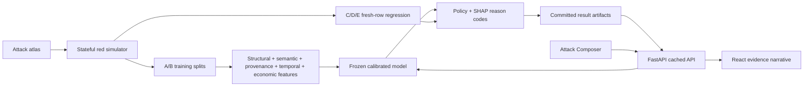

# AI Defense Lab

AI Defense Lab is a reproducible red-team and blue-team system for agentic-payment fraud. Its release-custodied synthetic signatures verify benchmark integrity; their fixture private keys are publicly derivable and do not prove real-world authorization or what a person intended. This project measures that intent-integrity gap with a frozen model and explicitly scoped evaluation evidence.

All identities and payment events are synthetic. Attack excerpts are truncated, watermarked, and non-operational. Read [Responsible use](RESPONSIBLE_USE.md) before changing the attack corpus.

## Architecture

The pipeline separates training, one-shot evaluation, runtime evidence, and the browser narrative:



The `defend/` package cannot import `sim/attacks/heldout/`. Training reads only splits A and B. The frozen model scores fresh C, D, and E rows once, and its file hash must remain unchanged.

## Evaluation scope

The signed V4 claim is a **fresh-row post-remediation regression**, with `independent_holdout=false`. It is not a new-family claim: prior families were disclosed before remediation. The preserved lineage names `GPF-A20 / ttl_dormancy` and `GPF-C04 / synthetic_identity_bust_out`, and binds the prior V3 preregistration, consumed attempt, and failed release by exact SHA-256 and mode `0444`. Latency is benchmarked on A+B only; protected C/D/E rows receive exactly one inference pass.

## Local quickstart

Install `uv` and Node.js 20 with npm first. `make setup` installs the locked dependencies, browser, and a project-local MiniLM cache that the release manifest and container both verify. Acceptance also requires Docker, `ffmpeg`, `ffprobe`, and a populated design-jury cache.

Create the Ed25519 release key once outside the repository, export only its paths, then verify the preserved one-shot evidence, recreate or verify every repeatable stage, and start the local site:

```bash
make setup
.venv/bin/python scripts/release.py --generate-key
export AI_DEFENSE_RELEASE_PRIVATE_KEY="$HOME/.config/ai-defense-lab/release-ed25519.pem"
export AI_DEFENSE_RELEASE_PUBLIC_KEY="$HOME/.config/ai-defense-lab/release-ed25519.pub.pem"
make evaluation-preregister
make all
make app
```

`make evaluation-preregister` is an explicit one-time custody step: it verifies the exact read-only V3 lineage, then exclusively creates the canonical mode-`0444` V4 preregistration. It refuses an existing target or any partial V4 attempt/release state and is intentionally not part of `make all`.

Open <http://localhost:8000> after `make app`. The current signed local process and `make e2e` use port 8010, so open <http://127.0.0.1:8010> when following the local verification commands above. `make all` downloads only the public OpenML marginal reference, runs its required 200,000-event marginal gate, generates 50,000 events with the canonical synthetic simulator, trains the model, runs the arena before evaluation, executes the external challenge, builds the site, verifies the release, and runs unit and real-browser tests. The event manifest records an explicit null behavior-profile hash, its file hash and count, `synthetic_pii=true`, and zero API calls. It never downloads UCI/Complete Journey data or invokes an entity-fidelity lifecycle. The server reads committed artifacts, except for one bounded frozen-model inference in `POST /compose`.

## Entity-behavior fidelity limitation

Enhanced entity-behavior fidelity is not certified for this hackathon release. V4 stopped during calibration development because its same-day-repeat stratum had 31 customers against a preregistered minimum of 32; it never froze a protocol or ran readiness, diagnostic, or sealed scoring. MRS2 then produced an immutable `STOP_FAIL`: orientation-free max-seed D was `0.8642926`, its 95% bootstrap interval was `[0.8519410, 0.8801393]`, and the preregistered upper limit was `0.65`.

The signed release requires byte-exact copies of the reviewed V4 failure, MRS2 preregistration, consumed one-shot attempt, and MRS2 failure. It exposes them as a `STOP_FAIL` known limitation; it never promotes them to a pass or uses the failed profile to generate production events. Qualification remained unopened, retry is forbidden, and UCI sources were not accessed by MRS2. `make clean` preserves immutable/read-only artifacts and every entity-fidelity or lifecycle record.

## Real data and external attack evidence

Release fidelity uses one pinned public dataset:

- [OpenML credit-card fraud dataset 1597](https://www.openml.org/d/1597) for the 200,000-event marginal fidelity gate

The gate covers amount and elapsed-time marginals only; it does not override the failed entity-behavior result. The preserved V4 history references UCI Online Retail, while MRS2 uses aggregate-only Complete Journey development evidence. Those sources are not opened by the release pipeline, and no row-level source data ships in the application or container.

The sealed external challenge cross-references pinned versions of [MITRE ATLAS](https://atlas.mitre.org/), the [OWASP Top 10 for Agentic Applications](https://genai.owasp.org/resource/owasp-top-10-for-agentic-applications-for-2026/), and [AgentDojo banking injection tasks](https://github.com/ethz-spylab/agentdojo). Each case is labeled as an exact local generator, a safe behavioral proxy, or unsupported and unscored. The harness does not execute live attacks, contact real payment systems, or include operational payloads.

The release signature authenticates the bundled AgentDojo aggregate bytes and their link from the external challenge; it does not authenticate the provider run or unavailable raw logs. The artifact therefore remains `authenticity_verified=false`.

Run the challenge against the current frozen model with:

```bash
make external
```

## Release and acceptance gates

`make release` builds and re-verifies `results/release_manifest.json`. The manifest requires a passing `evaluation_v4_release.json`, binds its scoped claim and active preregistration/attempt, and preserves the failed V3 lineage exactly. It also binds the frozen model, runtime source, event and split hashes, explicit null behavior-profile provenance, market-price data, exact local MiniLM cache, frontend bundle, dependency locks, digest-pinned base images, the passing marginal gate, byte-exact entity `STOP_FAIL` evidence, vaccination result, and external challenge. A broken train→arena→evaluation chain, any arena access to C/D/E, an overclaimed evaluation scope, failed contamination checks, or latency at/above 100 ms keeps `/health` unready and evidence routes return HTTP 503.

Run the post-release acceptance sequence with:

```bash
make acceptance
```

Acceptance repeats the real end-to-end browser test, evaluates the recorded screenshots from the populated design-jury cache, starts the production image with networking disabled, and records the four-minute API-backed demo video. Populate the vision cache after a real browser run when the visual design changes:

```bash
make e2e
python scripts/design_jury.py --populate-codex
make design-jury-from-cache
```

The recommended jury provider is the locally authenticated `codex` CLI (tested with Codex CLI 0.147.0). `--populate-codex` runs `codex exec` with `gpt-5.6-sol`, six local screenshots, a strict output schema, read-only sandboxing, ephemeral mode, ignored user config, and no API-key/base-URL/org environment variables. It records only bounded provider/version/model provenance and the final-output SHA-256; it does not store a fake response ID or usage record. `--from-cache` defaults to Codex, so the existing `make design-jury-from-cache` acceptance recipe replays Codex caches without changing the V4-bound Makefile.

The legacy `--populate-openai` path remains available for an actual `OPENAI_API_KEY`-backed Responses API run. Its cache namespace is provider-bound and cannot collide with Codex caches. The Makefile's `design-jury-populate` recipe intentionally remains the preserved OpenAI path; use the explicit Codex command above when populating the acceptance cache.

Force a fresh five-round arena instead of using a matching verified cache with:

```bash
make arena-rerun
```

## Offline runtime smoke test

The container smoke gate requires `AI_DEFENSE_RELEASE_PUBLIC_KEY` to name the external public key. It verifies that key before building, mounts a byte-identical UID-10001 staging copy read-only at `/run/ai-defense/release-ed25519.pub.pem`, starts the production image with `--network none`, a read-only root filesystem, dropped capabilities, and no-new-privileges, then requests every evidence route and performs a live composer inference:

```bash
make container-smoke
```

No public URL is claimed. See [BLOCKERS.md](BLOCKERS.md) for the external deployment prerequisite; this repository does not publish or deploy as part of `make all` or `make acceptance`.

## Amended release packaging and AWS App Runner

The root `Makefile` is byte-bound by the V4 preregistration and intentionally remains unchanged. Deployment-only targets live in `deploy/Makefile`; none of them simulate, train, run the arena, or evaluate C/D/E. `verify` consumes the signature-verified amendment automatically, while `release-amended` is the explicit signing path for repeatable runtime or packaging changes:

```bash
make -f deploy/Makefile verify
make -f deploy/Makefile release-amended  # only when an intentional re-sign is required
make -f deploy/Makefile package          # build and verify locally; no AWS calls
make -f deploy/Makefile deploy-plan      # no AWS, Docker, release, or network calls
make -f deploy/Makefile deploy           # the only cloud-mutating target
```

The package target verifies the current signed release, confirms the root `Makefile` still matches its preregistered hash, builds the digest-pinned production image, adds only the external Ed25519 public key in a final image layer outside `/app`, and verifies that clean image with networking disabled. Raw `data/events.jsonl` and `sim/attacks/heldout` are asserted absent. Verification uses the immutable amendment and frozen snapshot; it does not rescore protected C/D/E rows.

App Runner settings are in `deploy/apprunner.json`. Before a real deployment, install AWS CLI v2 and export `AWS_REGION`, `APP_RUNNER_ECR_ACCESS_ROLE_ARN`, and `AI_DEFENSE_RELEASE_PUBLIC_KEY`. Because AWS exposes no read-only API that proves pre-cutoff customer eligibility, an authorized account owner must also confirm the account was already an App Runner customer by setting `APP_RUNNER_EXISTING_CUSTOMER_CONFIRMED=true`. The public-key path must be absolute, outside this repository, and non-writable. The access role must belong to the active account, trust `build.apprunner.amazonaws.com`, and grant `AWSAppRunnerServicePolicyForECRAccess`. The script validates the eligibility assertion, AWS credentials, and App Runner access before any Docker build or cloud mutation, creates an encrypted immutable-tag ECR repository when absent, authenticates with `get-login-password`, pushes a release-specific image, creates or updates the service with automatic deployments disabled, configures HTTP `/health`, waits for the exact operation, verifies the deployed digest/configuration, and finally smokes the public HTTPS URL. It never prints credential material.

AWS announced that App Runner stopped accepting new customers on March 31, 2026; the target account must therefore already be eligible for App Runner. If it is not, EC2 or ECS is the deployment fallback, but no second deployment implementation is included here. See the official [App Runner create-service documentation](https://docs.aws.amazon.com/apprunner/latest/api/API_CreateService.html), [ECR access-role requirements](https://docs.aws.amazon.com/apprunner/latest/dg/security_iam_service-with-iam.html), [HTTP health-check settings](https://docs.aws.amazon.com/apprunner/latest/dg/manage-configure-healthcheck.html), and [ECR authentication flow](https://docs.aws.amazon.com/cli/latest/reference/ecr/get-login-password.html).

## Evidence artifacts

The interface reads measured files only:

- `results/generalization.json`: known, adaptive, and fresh-row regression recalls plus the explicit V4 scope
- `results/evaluation_v4_preregistration.json`: predeclared fresh-row post-remediation contract
- `results/evaluation_attempt_v3.json`: consumed one-shot V4 receipt
- `results/evaluation_v4_release.json`: active passing evaluation terminal
- `results/evaluation_v3_preregistration.json`, `results/evaluation_attempt_v2.json`, `results/evaluation_release.json`: exact mode-`0444` historical V3 lineage
- `results/metrics.json`: precision-recall, calibration, money weighting, latency, recall, and ablations
- `results/arena_log.json`: in-distribution hardening, separate from the fresh-row regression
- `results/external_attack_challenge.json`: safe external-source challenge outcomes and unsupported cases
- `results/fidelity.json`: passing 200,000-event marginal fidelity gate
- `results/entity_fidelity_v4_development_failed.json`: immutable V4 calibration `STOP_FAIL`
- `results/entity_fidelity_mrs2_development.json`: immutable MRS2 entity-behavior `STOP_FAIL`
- `results/release_manifest.json`: fail-closed runtime integrity binding
- `results/model.pkl`: frozen model used by the interactive composer

The API returns HTTP 503 when required evidence is missing. It never substitutes a hand-authored demo number.

## Record the backup video

Record the real API-backed four-minute tour after the release passes:

```bash
make video
```

The recorder rejects fixture data, browser errors, network errors, non-200 API responses, and failed composer inference before it writes `results/demo-video.mp4`.
